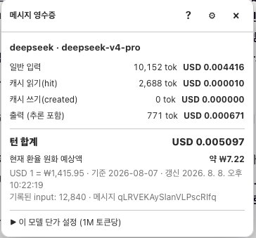
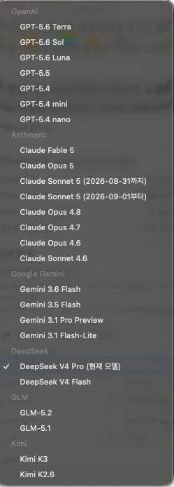

# Marinara Token Cost Receipt

Marinara Engine personal extension showing per-message token usage and estimated text API cost. Latest version: **v3.1.0**.

## Installation

Install the personal extension package containing `manifest.json`, `presets.js`, and `extension.js`. The `manifest.json` preserves the required script load order.

## Documentation

- [Korean setup guide](README-KO.md)
- [Pricing sources and billing limitations](PRICING-SOURCES.md)

Old version folders have been removed from the current tree; their contents are retained in Git history.

## Screenshots

